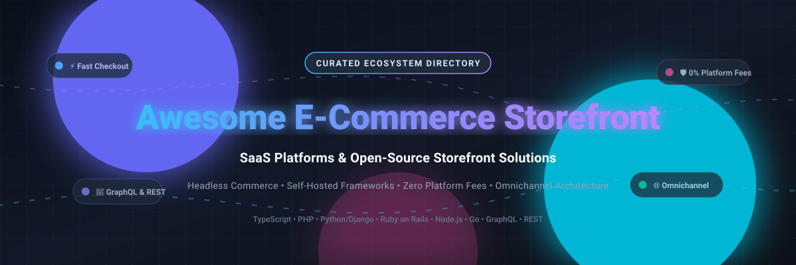

  

# 🛒 Awesome E-Commerce Storefront 🛍️

### 🌟 Curated Directory of SaaS Platforms & Open-Source Digital Commerce Engines 🚀
*A production-grade guide to Headless Commerce, Self-Hosted Storefronts, Modular Shopping Carts & Transaction-Fee-Free Alternatives*

  
  
  
  
  

---

## 📖 Overview & Ecosystem Summary

Welcome to the **Awesome E-Commerce Storefront** repository! 🌐 This resource tracks leading **SaaS storefront builders** and **open-source e-commerce frameworks**. Whether you are building an online boutique, launching an enterprise omnichannel marketplace, or architecting a headless commerce platform where you retain total ownership over checkout logic, customer data, and payment gateways—this guide breaks down your best alternatives.

### 🎯 Key Architectural Paradigms
- **☁️ Managed SaaS Commerce**: High-velocity, all-inclusive hosting with turnkey features (Shopify, BigCommerce, Wix, Squarespace) where operational maintenance is abstracted away.
- **⚡ Modern Headless Commerce**: API-first backends (Medusa, Saleor, Vendure, Reaction Commerce) decoupled from custom React, Next.js, or mobile apps via REST and GraphQL.
- **🛠️ Self-Hosted Frameworks**: Complete code and database ownership without platform transaction taxes (WooCommerce, Bagisto, PrestaShop, OpenCart, Sylius, Spree, Solidus).

---

## 📑 Table of Contents
- [📊 Sector Overview & Market Dynamics](#-sector-overview--market-dynamics)
- [☁️ SaaS / Hosted Platforms](#️-saashosted-platforms)
- [💻 Open-Source GitHub Projects](#-open-source-github-projects)
- [🤝 How to Contribute](#-how-to-contribute)
- [💖 Support](#-support)
- [⭐ Star History](#-star-history)
- [⚖️ Disclaimer](#️-disclaimer)

---

## 📊 Sector Overview & Market Dynamics

The global e-commerce software and storefront platform market is estimated at approximately **$8 billion to $13.9 billion** (projected to reach over $20 billion by 2030, growing at a ~12–15% CAGR). The sector exhibits **moderate concentration with a bifurcated dynamic**: while SMB and plug-and-play hosted commerce is heavily concentrated around dominant category winners like Shopify, enterprise and technical architecture remains fragmented and increasingly decentralized across composable/headless API layers and self-hosted open-source ecosystems.

---

## ☁️ SaaS/Hosted Platforms

| Product | 🏢 Company Size (Valuation / Revenue) | 💳 Pricing (Starting) | 🎁 Free Tier / Trial Limits | 📝 Description |
|---|---|---|---|---|
| **[Shopify](https://www.shopify.com/)** | **~$200B+ Market Cap** (~$14.2B TTM Revenue) | Basic: **$29/month** (annual) or $39/month (monthly); Grow: **$79/month**; Advanced: **$299/month**; Plus: ~**$2,300/month** | **3-day free trial** (often paired with a promotional $1/month for the first 3 months; full feature testing with no permanent free tier) | Leading hosted commerce platform with the broadest app ecosystem. Plans chosen by features (not revenue caps). **Third-party payment gateways add extra fees on top of gateway processing** [citation:3]. |
| **[Squarespace Commerce](https://www.squarespace.com/)** | **$7.2B Valuation** (Acquired by Permira in 2024; ~$1.1B+ Revenue) | Basic: **$19/month** (annual) or $25/month (monthly; 2% store transaction fee); Core: **$29/month** (annual, 0% store transaction fee); Plus: **$49/month**; Advanced: **$99/month** | **14-day free trial** (unlimited trial store building, but cannot publish or process live checkout payments without upgrading) | Polished content-and-commerce presentation for creators and modest catalogs. Tiered plans range from Basic (2% transaction fee) to Core/Plus/Advanced (0% store transaction fees) [citation:6]. |
| **[Wix eCommerce](https://www.wix.com/)** | **~$3.5B Market Cap** (~$2.2B TTM Revenue) | Core: **$29/month**; Business: **$39/month**; Business Elite: **$159/month** (annual billing) | **Free-for-ever plan** (limited to 500 MB storage, 1 GB bandwidth, wixsite subdomain, and Wix branding; **zero checkout or payment processing capabilities**) | Visual website builder with commerce layer. Best for design-led small businesses that prioritize editing the entire site without technical work. **Commerce depth is shallower than Shopify or BigCommerce** [citation:7]. |
| **[Ecwid](https://www.ecwid.com/)** | **$500M Valuation** (Acquired by Lightspeed; ~$20M+ Revenue) | Venture: **$29/month** (annual) or $35/month (monthly); Business: **$49/month** (annual) or $65/month (monthly); Unlimited: **$119/month** (annual) or $149/month (monthly) | **Free-for-ever plan** (strictly limited to **5 products** in catalog, no digital goods, no discount coupons, and basic online storefront) | Embeddable shopping cart that adds e-commerce to any existing website. Features flexible widgets and integrations [citation:9]. |
| **[BigCommerce](https://www.bigcommerce.com/)** | **~$230M Market Cap** (~$342M Annual Revenue) | Core: **$29/month** (annual) or $39/month (monthly); Growth: **$79/month** (annual) or $105/month (monthly); Pro: **$299/month** (annual) or $399/month (monthly) | **15-day free trial** (standard sandbox access with test checkout, no permanent free tier) | Hosted commerce with native B2B and catalog depth. **June 2026 pricing tightened revenue caps**: Core now tops out at **$30K trailing 12-month sales**. **Open Payment Provider Fee**: 2% (Core), 1% (Growth), 0.6% (Scale) for non-embedded gateways [citation:4]. |
| **[Shopware Cloud](https://www.shopware.com/)** | **Private / ~$100M+ Raised** (Carlyle/PayPal backed; €12B+ GMV) | Rise Cloud: **from €600/month**; Evolve Cloud: **€2,400/month**; Beyond: Quote-based | **Free Community Edition** (open-source self-hosted with no platform fee; paid cloud editions provide 30-day trial environments on request) | European commerce platform. **Community Edition is free** (self-hosted); **Rise cloud from €600/month** adds unlimited sales channels and agentic commerce [citation:8]. |

---

## 💻 Open-Source GitHub Projects

Curated open-source projects sorted in **descending order by GitHub Stars_Count**. Each project's Stars_Badge links directly to its official stargazers page.

| Project | ⭐ GitHub_Stars | 🧰 Technology / Stack | 📜 License | 📝 Description |
|---|---|---|---|---|
| **[Medusa](https://github.com/medusajs/medusa)** |  | Node.js, TypeScript | MIT / Commercial (Enterprise) | **Leading headless commerce framework for TypeScript teams.** REST Store & Admin APIs, customizable workflow engine, modules, and API routes in one unified codebase. Medusa Cloud starts at $29/mo with 0% GMV platform tax. |
| **[Bagisto](https://github.com/bagisto/bagisto)** |  | PHP, Laravel, Vue.js | MIT | **Complete open-source Laravel e-commerce platform.** Includes multi-currency, localized inventory, multi-vendor marketplace features, and a GraphQL/REST API layer out of the box with zero licensing fees. |
| **[Saleor](https://github.com/saleor/saleor)** |  | Python, Django, GraphQL | BSD-3-Clause | **GraphQL-first headless commerce engine.** Built for high performance and omnichannel experiences. Features granular GraphQL APIs, webhooks, and seamless extensibility via isolated microservices. |
| **[Spree Commerce](https://github.com/spree/spree)** |  | Ruby on Rails, Turbo | BSD-3-Clause | **Modular, headless Ruby on Rails commerce platform.** Backed by a battle-tested REST API, multi-store support, enterprise subscription capabilities, and native Docker self-hosting setups. |
| **[Reaction Commerce](https://github.com/reactioncommerce/reaction)** |  | Node.js, GraphQL, MongoDB | GPL-3.0 | **Event-driven, real-time headless commerce engine.** Designed with microservices architecture, GraphQL APIs, and NPM plugin modularity for high-scale enterprise retail storefronts. |
| **[Magento Open Source](https://github.com/magento/magento2)** |  | PHP, MySQL, Elasticsearch | OSL-3.0 | **Enterprise-grade open-source commerce ecosystem.** Full-featured monolithic storefront with extensive REST/GraphQL APIs, advanced catalog depth, multi-brand management, and massive third-party extensions. |
| **[Vue Storefront](https://github.com/vuestorefront/vue-storefront)** |  | TypeScript, Vue, Nuxt | MIT | **Leading Frontend-as-a-Service (FEaaS) & headless storefront boilerplate.** Connects seamlessly to headless commerce backends like Medusa, Commercelayer, BigCommerce, Shopify, and Magento. |
| **[WooCommerce](https://github.com/woocommerce/woocommerce)** |  | PHP, WordPress | GPL-3.0 | **The world's most widely deployed open-source commerce engine.** Powers millions of websites worldwide with 0% platform fee, endless theme/plugin customization, and full database self-sovereignty. |
| **[PrestaShop](https://github.com/PrestaShop/PrestaShop)** |  | PHP, Symfony | OSL-3.0 | **Accessible open-source e-commerce platform for startups and SMBs.** Runs efficiently on accessible cloud/shared hosting, paired with an extensive international add-on module and theme ecosystem. |
| **[Vendure](https://github.com/vendure-ecommerce/vendure)** |  | TypeScript, NestJS, GraphQL | GPL-3.0 / Commercial | **Modern GraphQL-first headless commerce framework.** Crafted with TypeScript and NestJS for maintainability, custom B2B workflows, omnichannel fulfillment, and rapid developer velocity. |
| **[Sylius](https://github.com/Sylius/Sylius)** |  | PHP, Symfony | MIT / Commercial (Plus) | **Flexible PHP commerce framework for bespoke B2C and B2B requirements.** Powered by Symfony components, API Platform REST APIs, test-driven development conventions, and modern web architectural standards. |
| **[OpenCart](https://github.com/opencart/opencart)** |  | PHP, MySQL | GPL-3.0 | **Lightweight PHP e-commerce platform.** Features native multi-store control from a unified admin console, built-in Twig templating, numerous gateway integrations, and zero platform usage overhead. |
| **[Solidus](https://github.com/solidusio/solidus)** |  | Ruby on Rails | BSD-3-Clause | **High-volume Rails e-commerce framework.** Forked from Spree with a relentless focus on stability, core scalability, unit test coverage, and complex custom promotion/checkout pipelines. |

---

## 🤝 How to Contribute

Contributions are warmly welcomed! 🌟 To add a new platform or update existing metrics:

1. 🍴 **Fork the repository** to your GitHub account.
2. 🌿 **Create a new branch** (`git checkout -b feature/add-new-storefront`).
3. ✍️ **Add or edit entries in `README.md`** following the established table structure:
   - Ensure SaaS entries include verified starting prices, exact free tier / trial terms, and valuation or revenue figures.
   - Ensure Open-Source entries include correct stargazer badges linked to `/stargazers`, tech stack, license, and sorted order.
4. 🚀 **Submit a Pull Request** with a clear description and credible reference links.

---

## 💖 Support

If you find this curated collection helpful for your projects, business, or open-source stack exploration, consider showing your support:

- ⭐ **Star this repository** to help other developers and merchants discover it!
- 🍴 **Fork & Share** with your fellow engineers, founders, and e-commerce teams.
- ☕ **Sponsor the Maintainer**: Support ongoing curation, open-source projects, and research by buying a coffee at the [GitHub Sponsors Dashboard](https://github.com/sponsors/ishandutta2007).

  

---

## ⭐ Star History

---

## ⚖️ Disclaimer

- 📌 This is a **community-curated guide** intended for informational and architectural evaluation purposes.
- 🔐 E-commerce storefronts handle sensitive financial information and customer PII; always implement PCI DSS compliance, TLS 1.3, input sanitation, and least-privilege role-based access control.
- 💡 **Total Cost of Ownership (TCO)**: Always assess hidden fees. While open-source frameworks carry 0% platform revenue taxes, remember to factor in server infrastructure, developer maintenance, database scaling, and payment gateway transaction rates.

---

  <b>Made with ❤️ for merchants, engineers, and digital commerce creators worldwide.</b> 
  <i>Let's make e-commerce storefronts more transparent, powerful, and accessible.</i>

